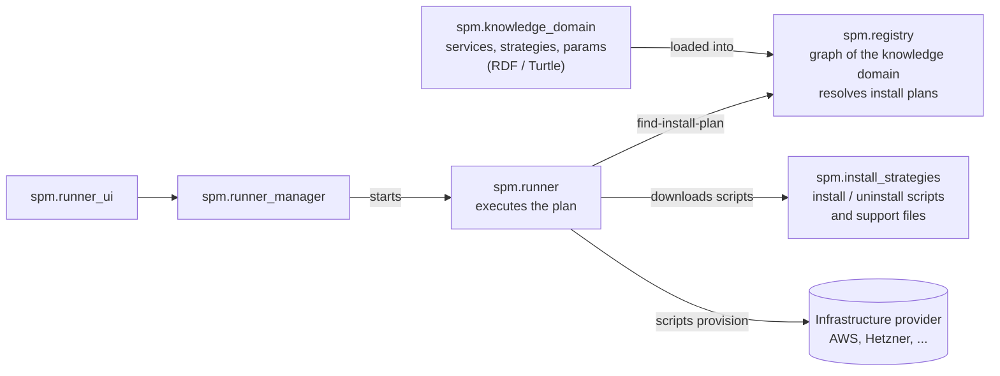

# Service Package Manager - Runner

`spm_runner` is the part of SPM that actually installs things. You tell it *what* you want (a service such as `Wordpress` or `Kutt`) and *where* you want it (an infrastructure provider such as `Hetzner` or `AWS`). It asks the registry for an install plan and runs every install strategy in that plan, in order. The outputs of one strategy (an SSH key, a database URL, ...) are passed on as inputs to the next.

> [!WARNING]
> **The runner downloads scripts from the internet and executes them on your machine, with your user's permissions and your cloud credentials.** Those scripts create real, billable infrastructure. Only point the runner at a registry you trust, review the plan with `--dry` before installing, and read [Security considerations](#security-considerations) first.

## Table of contents

- [Where the runner fits](#where-the-runner-fits)
- [How an install works](#how-an-install-works)
- [Security considerations](#security-considerations)
- [Building](#building)
- [Configuration](#configuration)
- [Commands](#commands)
- [User parameters](#user-parameters)
- [Writing scripts for the runner](#writing-scripts-for-the-runner)
- [Interactive mode](#interactive-mode)
- [Development](#development)
- [License](#license)

## Where the runner fits

SPM is split into several projects. The runner sits at the end of the chain: everything before it describes and resolves an installation; the runner executes it.



- **[`spm.knowledge_domain`](https://github.com/KyrtTech/spm.knowledge_domain)** defines the vocabulary: services, the platforms and application families they depend on, install strategies, the parameters strategies consume (`spm:requiresArgument`, `spm:optionalArgument`) and produce (`spm:producesParam`), and the runner environments they need (`spm:executedOnRunner`). For a guided tour, see [`examples/discover-identify-deploy.md`](https://github.com/KyrtTech/spm.knowledge_domain/blob/main/examples/discover-identify-deploy.md).
- **[`spm.registry`](https://github.com/KyrtTech/spm.registry)** loads that ontology into Neo4j and exposes it over HTTP. Its `find-install-plan` endpoint follows the dependency edges from a service to every strategy needed on the chosen provider. The runner never reads Turtle itself; it only talks to the registry.
- **[`spm.install_strategies`](https://github.com/KyrtTech/spm.install_strategies)** hosts the scripts referenced by `spm:installScripts`, `spm:uninstallScripts` and `spm:supportFiles`. The runner downloads them at install time.
- **[`spm.runner_manager`](https://github.com/KyrtTech/spm.runner_manager)** and **[`spm.runner_ui`](https://github.com/KyrtTech/spm.runner_ui)** start the runner from a web UI and drive it through [interactive mode](#interactive-mode).

## How an install works

Running `spm_runner install --application Wordpress --infra Hetzner`:

1. **Resolve the plan.** The runner calls `GET {registry}/find-install-plan?application=Wordpress&infra=Hetzner`. The registry maps the names to the IRIs `http://the-spm.org/entities/services#Wordpress` and `http://the-spm.org/entities/cloud_providers#Hetzner`. It returns the strategies needed: `PHP83Hetzner` to create a PHP 8.3 server, then `WordpressHetzner` to install WordPress on it.
2. **Prepare.** The runner starts each strategy with `SPM_PROJECT` and `SPM_ENV`, plus any [user parameters](#user-parameters) for that strategy. It also adds sizing values (`SPM_*`) taken from the service's `spm:serviceHasDependencyParameter`: the recommended values by default, the minimum ones with `--min-specs`.
3. **Run each strategy** in a fresh temporary directory:
   - download its install scripts and support files;
   - run each script with the environment above;
   - read the JSON the script wrote to `SPM_OUTPUT_PATH` (see [Writing scripts](#writing-scripts-for-the-runner)).
4. **Chain outputs.** Each output parameter is added to the environment of every later strategy, in `SHOUTY_SNAKE_CASE`. For example, `PHP83Hetzner` outputs `sshConnectionString` and `sshKey`, and `WordpressHetzner` receives them as `SSH_CONNECTION_STRING` and `SSH_KEY`. This is how the knowledge domain's "strategy A produces a parameter that strategy B requires" becomes a working pipeline.
5. **Persist state.** The environment before each step, and the final one, is saved to `.output/<step>.env.json`. SSH keys produced by a strategy are copied to `.output/<step>.pem` so they outlive the temporary directory.

## Security considerations

The runner is a remote code execution tool by design: what it runs is decided by the registry and by whoever hosts the install scripts, not by the runner. Treat running `spm_runner install` like piping a script from the internet into your shell.

### What the runner trusts

- **The registry decides what runs.** The install plan, including every script and support-file URL, comes from `SPM_CONFIG_REGISTRY`. Anyone who controls the registry, or its underlying knowledge domain and Neo4j data, controls the code executed on your machine.
- **Script hosts decide what the code is.** Scripts and support files are fetched from the URLs in the plan, currently `raw.githubusercontent.com/KyrtTech/spm.install_strategies`. Whoever can change those files changes what the runner executes.
- **There is no integrity check.** Downloads are not verified against a checksum or signature. The only protection is TLS, and only when the URLs use `https`. Nothing stops a registry from pointing at an `http` URL, and `SPM_CONFIG_REGISTRY` itself may be `http` (as in local development).

### What a script can do

- **Scripts run as your user.** No sandbox, container or separate account is used. A script can read, modify or delete anything your user can.
- **Scripts inherit your whole environment**, not just the SPM variables: cloud credentials (`AWS_*`, `HCLOUD_TOKEN`, ...), tokens, and `PATH`. Strategies rely on this to provision infrastructure, so every script in a plan can use those credentials.
- **Scripts create real resources and costs.** Installs create servers, databases and networks on your provider account. A failed or interrupted plan can leave resources running. Use `remove` or the provider console to clean up.

### Secrets on disk and in logs

- **`.output/` holds secrets in plain text.** `.output/<step>.env.json` contains every variable passed between strategies, including passwords, connection strings and SSH details. `.output/<step>.pem` holds the SSH private keys created by strategies. The files get default permissions from your umask.
- **`.output/` is wiped at the start of every `install`.** Copy anything you need to keep, such as SSH keys for created servers, before running another install from the same directory.
- **`--verbose` prints the full environment**, including secrets, to the terminal. Avoid it in shared terminals and CI logs.
- `.output/` and `.user_params/` are git-ignored; keep it that way.

### Interactive mode exposes a local control API

`--interactive` starts an HTTP server on `127.0.0.1:<port>` with **no authentication and CORS allowing any origin**. While it runs, any web page open in your browser can read the plan (`GET /job`), approve it (`PATCH /start-job`), and replace the environment variables for the install (`PATCH /envs`). Only use interactive mode on a trusted machine, close untrusted browser tabs while a job is pending, and don't change the port binding to a non-loopback address.

### Known limitations

- **Support-file paths are not fully contained.** The runner rejects absolute `localPath` values that point outside its temporary directory. It does not normalise `..`, so a value like `../file` is accepted and written outside it.
- **The temporary working directory is removed when a strategy finishes**, but files a script writes elsewhere (including through the gap above) are not cleaned up.

### Recommended practice

1. **Use a registry you control or trust.** Always use `https` for `SPM_CONFIG_REGISTRY` outside local development.
2. **Review before running.** Run with `--dry` first to see every strategy, script URL and support file in the plan, then read the scripts.
3. **Limit credentials.** Run with a dedicated, least-privilege cloud account or project, and short-lived credentials where the provider supports them.
4. **Isolate the runner.** For anything beyond local experiments, run it in a disposable VM or container, or in CI, rather than on a workstation holding other secrets.
5. **Protect the outputs.** Restrict `.output/` (for example `chmod 700 .output`), move SSH keys to a secure location, and delete the folder when you're done.
6. **Report vulnerabilities privately** through [GitHub security advisories](https://github.com/KyrtTech/spm.runner/security/advisories/new) rather than a public issue.

## Building

Requires the [Rust toolchain](https://www.rust-lang.org/tools/install).

```bash
cargo build --release
```

The binary is `target/release/spm_runner`.

The scripts the runner executes come from the install strategies, not from the runner itself. The machine running them needs whatever the strategy's runner definition lists. For example, `spm_runners:LinuxRunnerWithHCloud` needs the `hcloud` CLI, and `spm_runners:LinuxRunnerWithAWS` needs the AWS CLI.

## Configuration

| Environment variable | Purpose |
|----------------------|---------|
| `SPM_CONFIG_REGISTRY` | Base URL of the registry API, **including the `/v1/` prefix and the trailing slash**, e.g. `https://registry.the-spm.org/v1/` or `http://127.0.0.1:3000/v1/`. |

## Commands

### `install`

Resolves and runs the install plan for an application on an infrastructure provider.

```bash
SPM_CONFIG_REGISTRY=https://registry.the-spm.org/v1/ \
  spm_runner install --application Wordpress --infra Hetzner
```

| Option | Default | Description |
|--------|---------|-------------|
| `-a`, `--application` | (required) | Service name, the local name of its IRI in `entities/services` (e.g. `Wordpress`, `Kutt`, `Suri`). |
| `-i`, `--infra` | (required) | Provider name, the local name of its IRI in `entities/cloud_providers` (e.g. `AWS`, `Hetzner`, `GCP`). |
| `-u`, `--user-params` | none | Path to a [user parameters](#user-parameters) JSON file. |
| `-d`, `--dry` | off | Print the resolved plan and initial environment; do not run any script. |
| `-p`, `--project` | `SPM` | Exported as `SPM_PROJECT`; strategies use it to name resources. |
| `-e`, `--env` | `dev` | Exported as `SPM_ENV`. |
| `-m`, `--min-specs` | off | Use the minimum sizing values instead of the recommended ones. |
| `-v`, `--verbose` | off | Print the environment passed to each script. |
| `-w`, `--interactive` | off | Pause for approval through a local HTTP API (see [Interactive mode](#interactive-mode)). |
| `--port` | `8934` | Port of the interactive API. Requires `--interactive`. |

Start with a dry run to see what the knowledge domain resolves to:

```bash
SPM_CONFIG_REGISTRY=https://registry.the-spm.org/v1/ \
  spm_runner install -a Kutt -i AWS --dry
```

### `remove`

Runs the uninstall scripts (`spm:uninstallScripts`) of a single install strategy, together with its support files.

```bash
spm_runner remove --strategy RedisAWS --project kutt --env dev
```

Supports `--dry`, `--project` and `--env`, with the same meaning as for `install`. Use the same `--project` and `--env` values as the install, so the scripts find the resources they created.

### `search`

```bash
spm_runner search --name Kutt --category platform
```

Categories: `platform`, `install-strategy`, `infra-provider`. Currently this only prints the registry search URL it would query; it does not call the registry yet.

## User parameters

Optional arguments (`spm:optionalArgument`) and values you want to provide yourself are passed with `--user-params`. The file is keyed by **install strategy IRI**, then by the argument's `spm:argumentName`. The argument name becomes the environment variable name in `SHOUTY_SNAKE_CASE` (`serverType` becomes `SERVER_TYPE`).

```json
{
  "http://the-spm.org/entities/install_strategies#PHP83Hetzner": {
    "location":   { "type": "inline", "payload": "nbg1",  "export": "env" },
    "serverType": { "type": "inline", "payload": "cpx42", "export": "env" }
  }
}
```

Each entry has:

| Field | Values | Meaning |
|-------|--------|---------|
| `type` | `inline` | `payload` is the value itself (a string, or a JSON object). |
| | `path` | `payload` is a path to a local file. |
| | `reference` | `payload` names an environment variable already set by an earlier strategy (e.g. `redisHost`), whose value is reused. |
| `export` | `env` | The value is passed as an environment variable. |
| | `file` | The value is written to a temporary file, and the variable holds that file's path. Use this for parameters with `spm:isFile true`, such as a JSON config. |

For example, Suri's `linksConfig` argument expects a JSON file:

```json
{
  "http://the-spm.org/entities/install_strategies#SuriInstall": {
    "linksConfig": {
      "type": "inline",
      "export": "file",
      "payload": { "/": "https://github.com", "kyrt": "https://kyrt.tech" }
    }
  }
}
```

The `.user_params/` folder is git-ignored and is a convenient place for these files.

## Writing scripts for the runner

An install strategy's scripts (in [`spm.install_strategies`](https://github.com/KyrtTech/spm.install_strategies)) are executable files that:

- **Run in a temporary working directory** that also contains the strategy's support files, at their `localPath`.
- **Read their inputs from environment variables**: `SPM_PROJECT`, `SPM_ENV`, sizing values, user parameters, and outputs of earlier strategies (e.g. `SSH_CONNECTION_STRING`). The service's `spm:downloadURL` is also passed as `DOWNLOAD_URL` when the registry provides one.
- **Report their outputs** by writing JSON to the file named in `SPM_OUTPUT_PATH`. Use the parameter names from the knowledge domain:

```json
{
  "output_params": {
    "sshConnectionString": "root@203.0.113.10",
    "sshKey": "id_ed25519",
    "ip": "203.0.113.10"
  }
}
```

`sshKey` is treated specially. It is the name of a key file the script created in its working directory, and the runner copies that file to `.output/<step>.pem`. Later strategies then receive the absolute path to the copy.

## Interactive mode

With `--interactive` (`-w`), the runner starts an HTTP server on `127.0.0.1:<port>` and pauses at two points. This is how `spm.runner_manager` and `spm.runner_ui` let a user review a plan before anything is created.

| Endpoint | When | Purpose |
|----------|------|---------|
| `GET /job` | plan resolved | Returns the resolved plan (JSON list of strategies). |
| `PATCH /start-job` | plan resolved | Approves the plan; the runner continues. |
| `GET /envs` | after approval | Returns the initial environment (`SPM_PROJECT`, `SPM_ENV`, ...). |
| `PATCH /envs` | after approval | Body: a JSON object with new values for existing keys. The runner then runs every strategy. |

Endpoints called in the wrong state return `409 Conflict`. Per-strategy approval is not implemented yet: once the environment is confirmed, all strategies run back to back.

## Development

Run against a local registry (see [`spm.registry`](https://github.com/KyrtTech/spm.registry)):

```bash
SPM_CONFIG_REGISTRY=http://127.0.0.1:3000/v1/ cargo run -- install -a Kutt -i AWS --dry
```

[`scripts/run_web.sh`](scripts/run_web.sh) starts an interactive Kutt-on-AWS install against a local registry.

Tests in [`tests/`](tests) mock the registry with `mockito`:

```bash
cargo test
```

## License

This project is licensed under the [Apache License, Version 2.0](LICENSE).
